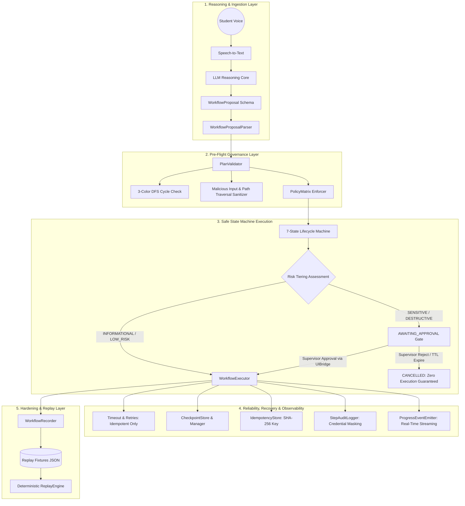
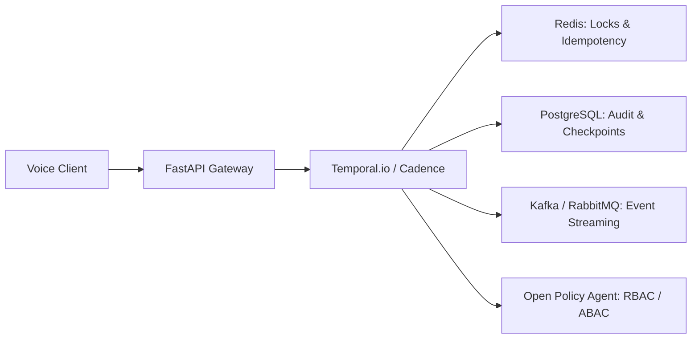

# Academia AI Voicebot — Master Project Architecture & Implementation Guide

**Project:** Agentic Workflow Engine for Academia AI Voice Co-Pilot  
**Team:** SDE 2 (`projects/sde-2-voicebot/`)  
**Student / Contributor:** Karthik N M  
**Document Type:** Complete End-to-End Technical Reference & Architectural Review  
**Coverage:** Days 1–30 (Weeks 1, 2, 3, and 4)  

---

## Table of Contents
1. [Executive Summary & Purpose](#1-executive-summary--purpose)
2. [How the Project Works: End-to-End Architecture](#2-how-the-project-works-end-to-end-architecture)
3. [Task-to-File Mapping (Which Feature is Where)](#3-task-to-file-mapping-which-feature-is-where)
4. [Real-World Use Cases & Business Value](#4-real-world-use-cases--business-value)
5. [Benefits & Key Advantages](#5-benefits--key-advantages)
6. [Disadvantages, Limitations & Trade-Offs](#6-disadvantages-limitations--trade-offs)
7. [Technologies Used & Why They Were Chosen](#7-technologies-used--why-they-were-chosen)
8. [Recommended Technologies for Next-Phase Production Scaling](#8-recommended-technologies-for-next-phase-production-scaling)
9. [How to Run, Test, and Verify the Entire Codebase](#9-how-to-run-test-and-verify-the-entire-codebase)

---

## 1. Executive Summary & Purpose

In modern conversational AI systems, Large Language Models (LLMs) cannot be allowed to execute real-world actions directly without safeguards. A voicebot might hallucinate actions, fall victim to prompt injections, run into infinite loops, or trigger irreversible student record changes (e.g., dropping courses or altering tuition records) without human consent.

The **Agentic Workflow Engine** acts as the **deterministic security and execution boundary** between raw LLM reasoning and the underlying university infrastructure. It takes reasoning proposals, validates them against Directed Acyclic Graph (DAG) constraints, enforces human approval gates for consequential operations, ensures bounded timeouts and retries, guarantees crash-resilience via checkpoints, and logs an append-only, redacted audit trail.

---

## 2. How the Project Works: End-to-End Architecture



### The 5-Phase Execution Lifecycle

1. **Ingestion & Proposal Conversion:**
   The student speaks into the voicebot (e.g., *"What is my CS101 schedule and can you update my advisor to Dr. Turing?"*). The Reasoning core creates a structured `WorkflowProposal`. The `WorkflowProposalParser` inspects the proposal, checks allow-listed tools, and converts it into a validated `WorkflowPlan`.

2. **Pre-Flight Validation & Safety Gates:**
   Before running a single tool, `PlanValidator` analyzes the execution DAG:
   - **Dependency Graph:** Rejects missing dependencies, duplicate step IDs, and self-dependencies.
   - **Cycle Detection:** Uses a 3-color Depth-First Search (DFS) algorithm to catch direct (`A -> B -> A`) and multi-node cycles.
   - **Input Defense:** Checks argument schemas against path traversals (`../../etc/passwd`), null bytes (`\x00`), out-of-scope fields (`additionalProperties: False`), and invalid numeric ranges.
   - **Policy Matrix Check:** Validates that the caller holds all required permissions (`kb:read`, `schedule:read`, `student:write`, etc.) and that timeouts do not exceed enterprise limits.

3. **7-State Lifecycle State Machine:**
   The workflow transitions deterministically through 7 states:
   `DRAFT` → `AWAITING_APPROVAL` → `RUNNING` ⇄ `PAUSED` → `SUCCEEDED` / `FAILED` / `CANCELLED`.
   - **Informational steps** run automatically.
   - **Consequential steps** (mutations or deletions) trigger an `ApprovalRequest` with an automatic TTL and halt execution in `AWAITING_APPROVAL`.

4. **Human-in-the-Loop Approval (UI Bridge):**
   The `WorkflowUIBridge` exposes endpoints for the administrative or advisor UI:
   - If approved: The workflow transitions back to `RUNNING` and resumes step execution.
   - If rejected or expired: The workflow safely transitions to `CANCELLED`, all downstream steps are aborted, and **zero tool logic is executed**.

5. **Observability, Recovery & Deterministic Replay:**
   - **Idempotency:** A SHA-256 hash of `(plan_id, step_id, tool_name, arguments)` is computed. Re-executing identical steps retrieves results directly from cache.
   - **Checkpoints:** State snapshots are captured after every step. Crashed workflows resume without re-running completed steps.
   - **Audit Trail:** Append-only log redacts passwords, tokens, API keys, and authorization headers (`***REDACTED***`).
   - **Deterministic Replay:** The `ReplayEngine` loads recorded runs and replays them offline to verify outputs and state transitions bit-for-bit.

---

## 3. Task-to-File Mapping (Which Feature is Where)

Here is the complete reference mapping every engineering deliverable to its exact source and test file:

| Day Range | Feature / Task | Implementation File | Key Classes / Schemas | Test File |
| :--- | :--- | :--- | :--- | :--- |
| **D1–D2** | Single-Source Pydantic Schemas | `src/workflow/schemas.py`<br>`schemas.py` | `WorkflowPlan`, `WorkflowStep`, `ToolSpec`, `ApprovalRequest`, `WorkflowResult`, `RiskLevel` | `tests/test_workflow_schemas_and_sm.py` |
| **D1–D2** | 7-State Machine Controller | `src/workflow/state_machine.py` | `WorkflowStateMachine`, `WorkflowState`, `InvalidStateTransitionError` | `tests/test_workflow_schemas_and_sm.py` |
| **D3–D4** | Harmless Mock Tools & Registry | `src/workflow/tools.py`<br>`mock_tools.py` | `BaseTool`, `MockKnowledgeSearchTool`, `MockCourseScheduleTool`, `ToolRegistry` | `tests/test_mock_tools_and_executor.py`<br>`tests/test_tool_registry.py` |
| **D3–D7** | Basic Step Executor | `src/workflow/executor.py` | `WorkflowExecutor`, `ExecutionEvent` | `tests/test_mock_tools_and_executor.py` |
| **D8–D9** | Plan Validation & Cycle DFS | `src/workflow/validator.py`<br>`plan_validator.py` | `PlanValidator`, `PlanValidationError` (3-color DFS cycle check) | `tests/test_plan_validator.py`<br>`tests/test_invalid_plans_and_transitions.py` |
| **D10–D11** | Approval TTL & Expiry Management | `src/workflow/executor.py`<br>`approval_manager.py` | `ApprovalRequest.is_expired()`, `expire_request()`, `reject_request()` | `tests/test_approval_manager.py` |
| **D12–D13** | Timeouts & Idempotent Retries | `src/workflow/executor.py`<br>`safe_executor.py` | `ThreadPoolExecutor` timeouts, `RetryPolicy`, non-idempotent protection | `tests/test_safe_executor.py`<br>`tests/test_week2_policy_and_safe_executor.py` |
| **D14** | Week 2 Live Demonstration | `demo.py` | Scenarios 1–5 (Approved, Rejected, Expired, Cycles) | `tests/test_demo.py` |
| **D15–D16** | Checkpoint & Resume Engine | `src/workflow/checkpoint.py` | `CheckpointStore`, `CheckpointManager`, `prepare_failed_step_recovery()` | `tests/test_week3_checkpoint_and_resume.py` |
| **D15–D16** | SHA-256 Idempotency Cache | `src/workflow/idempotency.py` | `IdempotencyStore`, `compute_key()` | `tests/test_week3_checkpoint_and_resume.py` |
| **D17–D18** | Redacted Audit Logging & Events | `src/workflow/audit.py` | `StepAuditLogger` (credential redaction), `ProgressEventEmitter` | `tests/test_week3_audit_and_events.py` |
| **D19–D20** | Reasoning Proposal & UI Bridge | `src/workflow/integration.py` | `WorkflowProposalParser`, `BackendApprovalService`, `WorkflowUIBridge` | `tests/test_week3_reasoning_and_ui_integration.py`<br>`tests/test_week3_end_to_end_integration.py` |
| **D21** | Week 3 Live Demonstration | `demo_week3.py` | 5 Integration Scenarios | Automated integration suite |
| **D22–D24** | Failure-Injection Suite | `tests/test_week4_failure_injection.py` | Spy tool verifying zero execution on cycles, path traversal, null bytes, timeouts | `tests/test_week4_failure_injection.py` (18 tests) |
| **D25–D27** | Deterministic Replay Engine | `src/workflow/replay.py` | `ReplayEngine`, `ReplayFixture`, `WorkflowRecorder` | `tests/test_week4_replay.py` (7 tests) |
| **D25–D27** | Saved Replay Fixtures | `tests/fixtures/replay/*.json` | 4 recorded traces (`successful`, `approved`, `rejected`, `timeout`) | `tests/test_week4_replay.py` |
| **D25–D27** | Authoritative Policy Matrix | `src/workflow/policy.py`<br>`POLICY_MATRIX.md` | `PolicyMatrix`, `PolicyRule`, `PolicyViolationError` | `tests/test_week4_policy_matrix.py` (13 tests) |
| **D28–D29** | Operations Runbook | `RUNBOOK.md` | Operating procedures, incident triage, crash recovery, audit inspection | Operational documentation |
| **D28–D29** | Adding a Safe Tool Guide | `SAFE_TOOL_GUIDE.md` | 6-step developer implementation guide with defense checklist | Developer documentation |
| **D30** | Week 4 Final Demonstration | `demo_week4.py` | Comprehensive 8-scenario live demonstration | Automated suite (153 tests) |
| **Release** | Module Documentation | `projects/sde-2-voicebot/README.md`<br>`README.md` | Architectural guide, API reference, Quickstart, Release Gate evidence | Public project documentation |

---

## 4. Real-World Use Cases & Business Value

### Real-World Student & University Scenarios
1. **Academic FAQ & Course Catalog Queries (Informational):**
   A student asks about graduation requirements or course prerequisites. The engine invokes `knowledge_search` safely in-memory and streams real-time progress events to the UI.
2. **Timetable & Classroom Location Lookups (Informational):**
   A student inquires about lecture timings and instructor room locations. The engine runs `course_schedule` with zero human friction.
3. **Student Profile Updates (Sensitive):**
   A student requests to change their academic advisor or emergency contact. Because mutating records is a **Category C (SENSITIVE)** action, the engine pauses, registers an approval request with a 5-minute TTL, and notifies the supervisor. Only after the advisor clicks "Approve" does the mutation occur.
4. **Course Drop / Withdrawal (Sensitive):**
   Dropping a course section impacts GPA and tuition standing. The engine halts execution, alerts the registrar, and if rejected, guarantees the student remains safely enrolled with zero data modifications.
5. **Account Deletion / Data Purge (Destructive):**
   A GDPR/FERPA account purge request is classified under **Category D (DESTRUCTIVE)**. It enforces administrator sign-off, strict non-retryability, and mandatory audit logging.

### Business Value
- **Zero Rogue Side-Effects:** Protects the institution from catastrophic automated deletions or unintended database updates caused by LLM hallucinations.
- **Regulatory Compliance:** Satisfies FERPA and data-privacy standards by generating immutable, credential-redacted audit logs for every tool call.
- **Fault-Tolerant Operations:** If backend servers restart or worker processes crash, workflows resume from their exact last checkpoint without re-charging fees or re-executing completed operations.

---

## 5. Benefits & Key Advantages

1. **Deterministic Guarantees:**
   LLMs are non-deterministic, but workflow execution is strictly deterministic. The engine guarantees that identical plans yield identical state transitions and outputs.
2. **Universal Consequential Escalation:**
   Safety is enforced at the schema and policy layers. Any step labeled `SENSITIVE` or `DESTRUCTIVE` is automatically coerced to `requires_approval = True`. Developers cannot accidentally bypass approval gates.
3. **Cryptographic Idempotency (SHA-256):**
   Prevents double-submissions (e.g., student clicking "Submit" multiple times or network retries creating duplicate records).
4. **Zero-Execution Rejection Guarantee:**
   If a request is rejected by a human or expires due to TTL, downstream execution halts immediately. Unit and failure-injection tests prove `tool.execute()` is called exactly 0 times.
5. **Pre-Flight Input Sanitization:**
   Blocks path traversal (`../../etc/passwd`), null bytes (`\x00`), and out-of-scope fields before data reaches application logic.
6. **Air-Gapped Mock Safety:**
   Runs completely in mock mode with zero live external network calls or unmonitored disk writes during development and testing.

---

## 6. Disadvantages, Limitations & Trade-Offs

While the architecture is robust and modular, an objective engineering assessment reveals several trade-offs:

1. **In-Memory Default Storage:**
   The default implementations of `CheckpointStore`, `IdempotencyStore`, and `StepAuditLogger` store data in RAM. While excellent for fast unit tests and zero-dependency deployments, a complete server power loss will lose active in-memory state unless persisted to a database.
2. **Thread-Pool Execution Model:**
   Steps are executed synchronously or wrapped in Python's standard `concurrent.futures.ThreadPoolExecutor`. In high-throughput enterprise environments with millions of concurrent workflows, an asynchronous or distributed event loop (e.g. Celery / Temporal) is preferable.
3. **Coarse In-Process Event Dispatcher:**
   `ProgressEventEmitter` uses an in-process callback observer pattern. For distributed microservice architectures, events must be routed through a message broker (e.g., RabbitMQ, Apache Kafka, or Redis Pub/Sub).
4. **Schema Rigidity:**
   Strict input schemas (`additionalProperties: False`) protect against malicious injections, but require updating the `ToolSpec` whenever new optional parameters are added to tools.

---

## 7. Technologies Used & Why They Were Chosen

| Technology / Library | Version | Purpose in this Project | Why It Was Chosen |
| :--- | :--- | :--- | :--- |
| **Python** | 3.10–3.13 | Core programming language | Clean syntax, rich standard library, and standard across AI/ML and agentic systems. |
| **Pydantic** | v2.x | Data validation & schema contracts | Fast, declarative validation; automatic schema coercion; strict runtime type safety. |
| **Pytest** | 9.x | Automated test runner & assertions | Industry-standard testing framework; supports fixtures, parameterized testing, and clean assertions. |
| **Concurrent Futures** | Standard Lib | ThreadPoolExecutor for step timeouts | Enforces execution timeouts on long-running or stalled tool calls without external dependencies. |
| **Hashlib (SHA-256)** | Standard Lib | Idempotency key generation | High-speed, collision-resistant cryptographic hashing for action deduplication. |
| **JSON & JSON Schema** | Standard Lib | Replay fixtures & tool contracts | Human-readable, portable data format compatible with OpenAI/Anthropic/Gemini tool-calling standards. |
| **UUID (uuid4)** | Standard Lib | Unique identifier generation | Collision-free generation of `plan_id`, `step_id`, `approval_id`, and `checkpoint_id`. |
| **Datetime & Timezone** | Standard Lib | UTC timestamping & TTL calculation | Guarantees timezone-aware timestamps for audit logs and precise approval TTL calculations. |

---

## 8. Recommended Technologies for Next-Phase Production Scaling

To evolve this engine from an SDE-2 internship release to a massive, global enterprise deployment, here is the recommended technology stack:



1. **Distributed Workflow Orchestrator: Temporal.io or Cadence**
   - *Why:* Temporal provides durable execution out of the box. Workflows can sleep for days awaiting human approvals, automatically survive server crashes, and handle distributed retries without custom checkpoint boilerplate.
2. **Fast Distributed Cache: Redis / Dragonfly**
   - *Why:* Replaces in-memory stores with shared, low-latency distributed caching for idempotency keys, distributed locks, and approval TTL keys.
3. **Durable Enterprise Storage: PostgreSQL (with SQLAlchemy or Prisma)**
   - *Why:* Replaces in-memory audit logs and checkpoints with ACID-compliant, queryable tables indexed by `session_id`, `student_id`, and `plan_id`.
4. **Real-Time Streaming: WebSockets & Server-Sent Events (SSE) via FastAPI**
   - *Why:* Directly connects `ProgressEventEmitter` to the frontend advisor and student portals so execution updates stream live to the browser.
5. **Decentralized Authorization: Open Policy Agent (OPA) or Casbin**
   - *Why:* Replaces hardcoded permission lists with externalized Attribute-Based Access Control (ABAC) policies.
6. **Containerized Tool Sandboxing: gVisor or Firecracker MicroVMs**
   - *Why:* If the engine ever runs arbitrary user-generated scripts or complex external plugins, microVM sandboxes provide military-grade kernel isolation.
7. **End-to-End Tracing: OpenTelemetry (OTel), Jaeger & Prometheus**
   - *Why:* Automatically traces voice latency from initial microphone capture to final tool execution in distributed traces.

---

## 9. How to Run, Test, and Verify the Entire Codebase

### 1. Clean-Clone Setup
```bash
# Clone the repository and navigate to the project directory
git clone https://github.com/divya182307-dot/voicebot-SDE2-teamm.git
cd voicebot-SDE2-teamm/projects/sde-2-voicebot

# Install required dependencies
pip install -r requirements.txt
```

### 2. Run All Automated Tests (153 Tests)
```bash
pytest -v
```
*Expected Result:* **153 passed in ~12 seconds** across 16 test modules.

### 3. Run the Final Live Demonstration (8 Scenarios)
```bash
python demo_week4.py
```

### 4. Run Earlier Weekly Demonstrations
```bash
# Week 3 Demonstration (5 Scenarios: Recovery, Audit, Idempotency, Proposals, UI Bridge)
python demo_week3.py

# Week 2 Demonstration (Scenarios: Plan Validation, Expiry, Retries)
python demo.py
```

---

## 10. Summary Checklist for Day 30 Release Gate

- [x] **Single Source of Truth:** All schemas live strictly in `src/workflow/schemas.py`.
- [x] **Safe Air-Gapped Mode:** Only harmless mock tools (`knowledge_search`, `course_schedule`); zero external sending.
- [x] **Pre-Flight Validation:** Rejects cycles, missing dependencies, duplicate IDs, and unregistered tools.
- [x] **Approval Invariants:** Consequential steps strictly require approval; rejection/expiry guarantees 0 tool calls.
- [x] **Bounded Retries & Timeouts:** Retries are strictly enforced only for idempotent operations.
- [x] **Recovery & Checkpoints:** Failed steps are recoverable without re-running completed steps.
- [x] **Deduplication:** SHA-256 idempotency cache prevents duplicate tool execution.
- [x] **Audit Redaction:** Passwords, tokens, and authorization keys are automatically redacted.
- [x] **Failure-Injection Tested:** 18 dedicated tests prove no tools run during attacks or failures.
- [x] **Deterministic Replay:** Replays recorded fixtures with 100% deterministic fidelity.
- [x] **Documented Governance:** Policy Matrix, Runbook, and Safe Tool Guide are fully committed.
- [x] **Zero Committed Secrets:** Verified with regex scans.
- [x] **All 153 Tests Passing:** 100% green.
