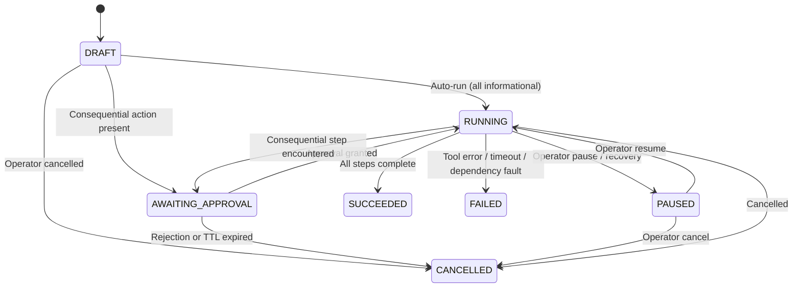

# Agentic Workflow Engine — Operations Runbook

**Workstream:** W4 — Agentic Workflow Engine (Week 4 / Days 22–30)  
**Team:** SDE 2 (`projects/sde-2-voicebot/`)  
**Author:** Karthik N M  
**Document Version:** 1.0.0 (Release Candidate)  

---

## 1. System Overview & Lifecycle

The Academiaai Agentic Workflow Engine orchestrates structured, multi-step actions on behalf of the voicebot reasoning agent. It guarantees deterministic execution, strict human-in-the-loop approval gating for consequential actions, step-level checkpointing, append-only audit logging with credential masking, and 100% offline mock execution mode.

### 7-State Lifecycle State Machine


---

## 2. Quickstart & Clean-Clone Setup

### Prerequisites
- Python 3.10+ (tested on Python 3.13)
- `pip` package manager

### Setup Steps
```bash
# 1. Clone repository and navigate to voicebot project directory
cd projects/sde-2-voicebot

# 2. Install dependencies
pip install -r requirements.txt

# 3. Run all automated verification tests (153 tests)
pytest -v

# 4. Run the Week 4 Live Demonstration
python demo_week4.py
```

---

## 3. Configuration Parameters

The workflow executor accepts the following runtime parameters during initialization:

| Parameter | Type | Default | Description |
| :--- | :--- | :--- | :--- |
| `plan` | `WorkflowPlan` | **Required** | The validated multi-step execution plan |
| `registry` | `ToolRegistry` | `DefaultRegistry` | Allow-listed tools registry |
| `caller_permissions`| `List[str]` | `None` (All) | Scopes granted to the caller (e.g. `["kb:read", "schedule:read"]`) |
| `default_step_timeout`| `float` | `None` | Default wall-clock execution limit per step in seconds |
| `default_approval_ttl_seconds` | `float` | `300.0` (5 min) | Time-to-live before pending approval requests auto-expire |
| `checkpoint_manager` | `CheckpointManager` | Auto-instantiated | Persistent state snapshot coordinator |
| `idempotency_store` | `IdempotencyStore` | Auto-instantiated | Deduplication store using SHA-256 keys |
| `audit_logger` | `StepAuditLogger` | Auto-instantiated | Append-only logger with credential redaction |
| `event_emitter` | `ProgressEventEmitter`| Auto-instantiated | Real-time typed event dispatcher |
| `backend_approval_service` | `BackendApprovalService` | `None` | Integration service for backend approval persistence |

---

## 4. Operational Procedures

### A. Monitoring & Real-time Progress Events
The engine emits structured, typed `ProgressEvent` records at every transition. Subscribe to events via `ProgressEventEmitter`:
```python
from src.workflow.audit import ProgressEventEmitter
from src.workflow.schemas import ProgressEventType, ProgressEvent

emitter = ProgressEventEmitter()

def handle_event(event: ProgressEvent):
    print(f"[{event.timestamp.isoformat()}] {event.event_type.value}: {event.message}")

emitter.subscribe(handle_event, event_type=ProgressEventType.APPROVAL_REQUESTED)
emitter.subscribe(handle_event, event_type=ProgressEventType.STEP_COMPLETED)
```

### B. Checkpoint & Resume from Crashes
Every step completion captures a full execution snapshot (`WorkflowCheckpoint`). If a worker crashes or encounters an error:
```python
from src.workflow.checkpoint import CheckpointStore
from src.workflow.executor import WorkflowExecutor

# 1. Retrieve the saved checkpoint
store = CheckpointStore()
checkpoint = store.load_checkpoint(plan_id="plan-123")

# 2. Re-instantiate executor from checkpoint (completed steps are automatically skipped)
executor = WorkflowExecutor.from_checkpoint(
    checkpoint=checkpoint,
    plan=plan,
    registry=registry,
)

# 3. Resume execution
result = executor.run()
```

### C. Failed-Step Recovery
When a step fails (e.g. invalid user input or external dependency glitch):
```python
from src.workflow.checkpoint import prepare_failed_step_recovery

# 1. Recover the plan: resets only the failed step back to PENDING, keeps completed steps intact
recovered_plan = prepare_failed_step_recovery(
    plan=plan,
    checkpoint=checkpoint,
    updated_arguments={"course_code": "CS101"},  # Optional corrected args
)

# 2. Run recovered executor
executor = WorkflowExecutor(plan=recovered_plan, registry=registry)
result = executor.run()
```

---

## 5. Triage & Incident Response

### Incident 1: Stuck / Pending Approval Request
- **Symptom:** Workflow is in `AWAITING_APPROVAL` state; execution halted.
- **Root Cause:** A consequential action (SENSITIVE or DESTRUCTIVE) was scheduled, awaiting operator confirmation.
- **Triage Action:**
  ```python
  from src.workflow.integration import WorkflowUIBridge

  bridge = WorkflowUIBridge(approval_service=approval_service, executor=executor)

  # Check pending approvals
  pending = bridge.get_pending_approvals()

  # Grant or Reject
  bridge.ui_approve(approval_id="appr-123", decided_by="supervisor_alice")
  # OR
  bridge.ui_reject(approval_id="appr-123", reason="Invalid student consent", decided_by="supervisor_alice")
  ```

### Incident 2: Expired Approvals
- **Symptom:** Approval request timed out (`ApprovalStatus.EXPIRED`); workflow transitioned to `CANCELLED`.
- **System Behavior:** Rejection/Expiry strictly guarantees ZERO tool execution.
- **Remediation:** If the action is still required, the user/voicebot must initiate a new reasoning proposal. Do NOT attempt to re-approve an expired approval ID (the engine explicitly raises `ValueError`).

### Incident 3: Tool Execution Timeout
- **Symptom:** Step failed with `TimeoutError`; workflow reached `FAILED`.
- **Root Cause:** Tool execution exceeded `timeout_seconds`.
- **Verification:** Check `step.is_idempotent`. If `is_idempotent=True`, verify retry attempts in the audit log. If `is_idempotent=False`, verify retries were strictly suppressed.

### Incident 4: Permission Scope Denial
- **Symptom:** Step failed with `PermissionError` or `PolicyViolationError`.
- **Resolution:** Verify caller credentials against `POLICY_MATRIX.md`. If legitimate, add the required scope to `caller_permissions` at executor initialization.

---

## 6. Audit Trail & Compliance Inspection

Every step writes an immutable audit record containing:
- `audit_id`, `plan_id`, `step_id`, `tool_name`, `status`, `attempts`, `duration_ms`, `idempotency_key`
- Sanitized input arguments (sensitive fields such as passwords, tokens, API keys, and authorization secrets are automatically redacted to `***REDACTED***`).
- Inspection query:
  ```python
  records = executor.audit_logger.get_plan_records(plan_id="plan-123")
  for r in records:
      print(f"{r.tool_name} | {r.status.value} | {r.duration_ms:.1f}ms | args={r.arguments}")
  ```
