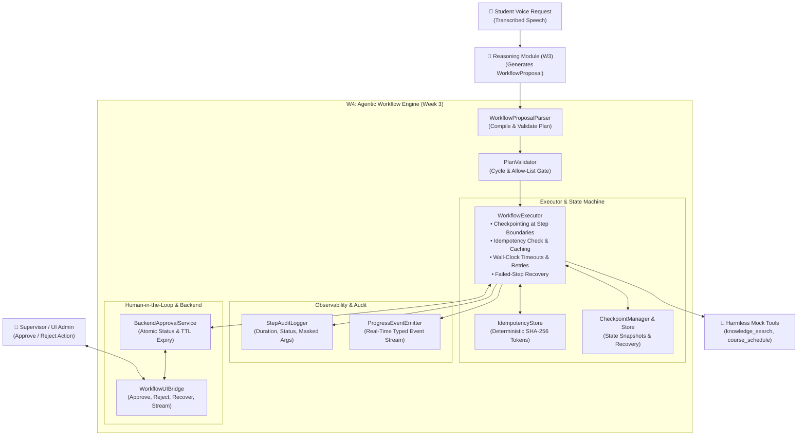

# 🔄 Voicebot SDE-2 — Agentic Workflow Engine: Week 3 Project Explanation

> **Contributor:** Karthik N M | **Workstream:** W4 — Agentic Workflow Engine | **Branch:** `team/sde-2-voicebot` | **Scope:** Week 3 (Days 15–21) Checkpoint & Resume, Audit Trail & Approval Integration

---

## 🎯 What Is Week 3 About?

In Week 3, the goal was to make agentic workflows **recoverable, observable, and fully integrated** across the voicebot architecture:
1. **Checkpoint and Resume (Days 15–16):** Capture execution snapshots at step boundaries. Resuming from a checkpoint **guarantees completed steps are never re-executed**.
2. **Failed-Step Recovery (Days 15–16):** When a step fails, execution halts and creates a failure checkpoint. Operators or systems can correct input parameters and recover the step seamlessly without touching prior successful steps.
3. **Idempotency Keys (Days 15–16):** Deterministic SHA-256 tokens derived from `(plan_id, step_id, tool_name, arguments)`. Caches results so repeat or duplicate requests return the cached output without invoking underlying tools.
4. **Step-Level Audit Trail (Days 17–18):** Every step writes an append-only, immutable `StepAuditRecord` detailing wall-clock `duration_ms`, execution status, outputs, errors, attempts, and automatically sanitized arguments (masking tokens, passwords, secrets).
5. **Real-Time Progress Events (Days 17–18):** Dispatch typed `ProgressEvent` milestones (`WORKFLOW_STARTED`, `STEP_STARTED`, `STEP_COMPLETED`, `APPROVAL_REQUESTED`, `APPROVAL_GRANTED`, `STEP_RECOVERED`, `WORKFLOW_COMPLETED`) to UI/backend subscribers.
6. **Reasoning Proposals & UI Integration (Days 19–20):** Ingest `WorkflowProposal` objects from the Reasoning (W3) engine, compile them into plans, run pre-execution validation via `PlanValidator`, interface with `BackendApprovalService`, and expose human-in-the-loop decision hooks via `WorkflowUIBridge`.
7. **Strict Duplicate & Expired Approval Protection (Days 19–20):** Proof that duplicate approvals or attempts to approve TTL-expired requests are strictly blocked and execute **zero tools**.
8. **Day 21 Team Gate & Demonstration (Day 21):** 115 passing tests (100% in mock mode) and live 5-scenario demo script (`demo_week3.py`).

---

## 📅 Week 3 Day-by-Day Deliverables (Days 15–21)

| Days | Phase | What Was Built | Key Files |
| :--- | :--- | :--- | :--- |
| **Days 15–16** | Checkpoint, Resume & Idempotency | • Step-boundary snapshotting into `WorkflowCheckpoint`<br>• Resuming without re-running completed steps (`from_checkpoint`)<br>• Failed-step recovery (`recover_failed_step`)<br>• `IdempotencyStore` with deterministic key derivation | `src/workflow/checkpoint.py`<br>`src/workflow/idempotency.py`<br>`src/workflow/executor.py` |
| **Days 17–18** | Step Audit Trail & Progress Events | • Append-only `StepAuditLogger` with credential masking<br>• Real-time `ProgressEventEmitter` with subscription listener model<br>• Duration tracking in milliseconds | `src/workflow/audit.py`<br>`src/workflow/schemas.py`<br>`src/workflow/executor.py` |
| **Days 19–20** | Reasoning Proposal & Backend/UI Bridge | • `WorkflowProposalParser` converting reasoning proposals to plans<br>• `BackendApprovalService` tracking multi-tenant approval states<br>• `WorkflowUIBridge` for UI approve, reject, retry, and event streaming<br>• Duplicate and expired approval protection | `src/workflow/integration.py`<br>`src/workflow/schemas.py` |
| **Day 21** | Team Gate & Live Demonstration | • 115 automated unit & integration tests passing in mock mode<br>• `demo_week3.py` demonstrating 5 end-to-end integration scenarios | `tests/`<br>`demo_week3.py` |

---

## 🏗️ Week 3 End-to-End System Architecture



---

## 🛡️ Acceptance Criteria Verification

| Acceptance Criteria | Implementation Details | Test Coverage |
| :--- | :--- | :--- |
| **1. Checkpoint & Resume** | Workflow states snapshotted into `WorkflowCheckpoint`. Resumed executors skip all `SUCCEEDED` steps. | `test_checkpoint_capture_after_steps`<br>`test_resume_does_not_rerun_completed_steps` |
| **2. Failed-Step Recovery** | `recover_failed_step` resets failed step to `PENDING` with corrected parameters. Completed steps remain intact. | `test_failed_step_recovery_without_rerunning_prior_steps` |
| **3. Idempotency Keys** | `IdempotencyStore` calculates SHA-256 digest from step context; cached outputs return immediately without tool invocation. | `test_idempotency_keys_prevent_duplicate_execution` |
| **4. Step-Level Audit Trail** | Every step logs `StepAuditRecord` with `duration_ms`, inputs (sanitized credentials), outputs, and timestamps. | `test_step_level_audit_trail_recorded`<br>`test_audit_trail_sanitizes_sensitive_fields` |
| **5. Real-Time Progress Events** | `ProgressEventEmitter` broadcasts typed `ProgressEvent` records to active UI listeners. | `test_progress_events_emitted_to_listeners` |
| **6. Reasoning Proposal Acceptance** | `WorkflowProposalParser` ingests reasoning proposals, validates against `PlanValidator`, and generates plans. | `test_reasoning_proposal_accepted_and_validated` |
| **7. Backend & UI Approval Controls** | `BackendApprovalService` and `WorkflowUIBridge` allow UI to list pending requests, approve, or reject. | `test_ui_approval_flow_resumes_workflow`<br>`test_ui_rejection_guarantees_zero_execution` |
| **8. Duplicate & Expired Protection** | Duplicate approvals raise `ApprovalIntegrationError`. Expired approvals strictly prevent tool execution. | `test_duplicate_approvals_rejected_and_never_execute_tool`<br>`test_expired_approvals_never_execute_tool` |
| **9. 100% Mock Mode & No Duplicate Schemas** | Reuses schemas from `src/workflow/schemas.py`; in-memory harmless mock tools; zero network dependencies. | **115 passing tests** |

---

## 💻 Commands to Run Week 3 Deliverables

```powershell
# Navigate to the project folder
cd "c:\SDE INTERNSHIP\projects\sde-2-voicebot"

# 1. Run all 115 unit and integration tests
python -m pytest tests -v

# 2. Run specifically the Week 3 test suites
python -m pytest tests/test_week3_checkpoint_and_resume.py tests/test_week3_audit_and_events.py tests/test_week3_reasoning_and_ui_integration.py tests/test_week3_end_to_end_integration.py -v

# 3. Run the live Week 3 demonstration (5 Scenarios)
python demo_week3.py
```
