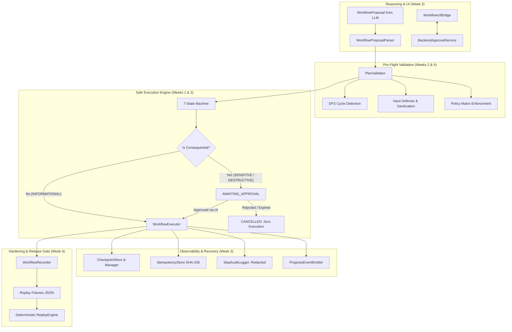

# Academia AI Voicebot — Week 4 Comprehensive Project Explanation
**Workstream:** W4 — Agentic Workflow Engine (Days 22–30: Hardening, Replay Fixtures, Policy Matrix, Runbook & Release Gate)  
**Student:** Karthik N M  
**Team:** SDE 2 (`projects/sde-2-voicebot/`)  
**Branch:** `team/sde-2-voicebot` / `karthik-nm`  

---

## 1. Executive Overview

Week 4 represents the **Hardening & Release Gate (Days 22–30)** phase of the Agentic Workflow Engine. Building on the foundations of Week 1 (Schemas & State Machine), Week 2 (Plan Validation & Safe Execution), and Week 3 (Checkpoint/Resume, Audit Trail & Reasoning/UI Integration), Week 4 hardens the engine for release through:

1. **Failure-Injection Testing:** Proving through automated testing that malicious arguments, cyclic graphs, duplicate submissions, timeouts, and rejected approvals **strictly guarantee zero unsafe tool execution**.
2. **Deterministic Replay Infrastructure:** Allowing past workflow runs to be recorded into immutable fixtures and replayed deterministically without invoking live or external systems.
3. **Authoritative Policy Matrix:** Formally documenting and actively enforcing the multi-dimensional security policy: **Tool Name × Risk Level × Approval Gate × Scopes × Retries × Timeouts**.
4. **Operations Runbook & Developer Guide:** Providing a production operations runbook (`RUNBOOK.md`) for triage and incident response, along with a step-by-step developer guide (`SAFE_TOOL_GUIDE.md`) for safely onboarding new tools.
5. **Final Comprehensive Demonstration (`demo_week4.py`):** An 8-scenario interactive walkthrough demonstrating normal execution, human approval gates, failure injections, replay fixtures, and policy enforcement.

---

## 2. Architectural Blueprint (Days 1–30)



---

## 3. Deep-Dive into Week 4 Deliverables

### Deliverable 1: Failure-Injection Test Suite (`tests/test_week4_failure_injection.py`)
This test suite uses dedicated `SpyTool` instances with invocation counters (`spy.call_count`) to verify that under adverse or malicious conditions, **tools never execute when they shouldn't**:

1. **Cyclic Plans:**
   - **Self-Loops (`A -> A`):** Blocked at plan construction; `call_count == 0`.
   - **Direct 2-Node Cycles (`A -> B -> A`):** Caught by `PlanValidator.validate_dependencies_and_cycles()`; `call_count == 0`.
   - **Multi-Node Cycles (`A -> B -> C -> A`):** Detected by 3-color Depth First Search (DFS); `call_count == 0`.
2. **Malicious & Out-of-Scope Tool Arguments:**
   - **Path Traversal (`../../etc/passwd`, `..\\windows\\system32`):** Neutralized by `BaseTool.validate_arguments()`; raises `ValueError` before reaching tool logic.
   - **Null Byte Injection (`cs101\x00exploit`):** Detected and rejected; `call_count == 0`.
   - **Out-of-Scope Extra Fields:** Enforced by schema `additionalProperties: False`; raises `ValueError`.
   - **Negative / Out-of-Bounds Integers (`max_results = -5`):** Checked against schema `minimum: 1`; raises `ValueError`.
   - **Unregistered Shadow Tools:** Rejected by allow-list registry.
3. **Duplicate Submissions & Protection:**
   - **Duplicate Step IDs:** Blocked by `WorkflowPlan` validation.
   - **Duplicate Step Submissions:** Re-running an identical step with a shared `idempotency_key` returns the cached result without invoking the tool a second time (`call_count == 1`).
   - **Duplicate Approval Attempts:** Approving an already approved request raises `ValueError("Duplicate approval rejected")`.
   - **Approving Rejected/Expired Requests:** Raises `ValueError("Illegal approval")`; zero tool execution.
4. **Step Timeouts & Retry Suppression:**
   - Steps with `timeout_seconds = 0.05` exceeding duration raise `TimeoutError` and transition to `FAILED`.
   - Non-idempotent steps (`is_idempotent = False`) are strictly prohibited from retrying even if a `RetryPolicy` is defined (`call_count == 1`).
5. **Rejected & Expired Approvals:**
   - When a consequential action is rejected by a human or expires due to TTL, the step is marked `CANCELLED`, remaining DAG steps are cancelled, and the tool is **never called** (`call_count == 0`).
6. **Permission Scope Violations:**
   - Callers lacking required permission scopes (e.g. caller holds `kb:read` but step requires `admin:delete`) are denied before any tool executes.

---

### Deliverable 2: Deterministic Replay Engine & Fixtures (`src/workflow/replay.py`)
Replay fixtures allow debugging, incident triage, and regression testing without invoking live APIs, mock tools, or external services:

1. **`WorkflowRecorder`:** Hooks into the execution lifecycle and captures:
   - Initial `WorkflowPlan` snapshot.
   - Step traces: `step_id`, `tool_name`, `arguments`, `status`, `result`, `error_message`, `duration_ms`, `idempotency_key`.
   - Ordered progress events and audit records.
   - Final terminal state (`SUCCEEDED`, `CANCELLED`, `FAILED`).
2. **`ReplayFixture` JSON Format:** Committed fixtures in `tests/fixtures/replay/`:
   - `successful_workflow_run.json`: Harmless 2-step informational query.
   - `consequential_approval_granted.json`: Sensitive profile update approved by human supervisor.
   - `consequential_approval_rejected.json`: Destructive action rejected by supervisor with zero execution.
   - `step_timeout_failure.json`: Step timeout failure trace.
3. **`ReplayEngine`:**
   - Loads fixture JSON files.
   - Replays the execution deterministically in memory.
   - Verifies that step arguments, statuses, outputs, and final workflow states match the recorded trace bit-for-bit.
   - Strict tamper detection: catches discrepancies if a tool name or argument payload was modified.

---

### Deliverable 3: Authoritative Policy Matrix (`src/workflow/policy.py` & `POLICY_MATRIX.md`)
The Policy Matrix is the single source of truth governing tool permissions, risk classifications, approval gates, and retry limits.

#### Canonical Policy Matrix Table

| Tool Name | Risk Level | Approval Required | Required Scopes | Failure Behavior | Max Timeout | Retries Allowed | Purpose |
| :--- | :--- | :---: | :--- | :--- | :---: | :---: | :--- |
| `knowledge_search` | `informational` | **NO** | `kb:read` | `fail_workflow` | 30.0s | Yes | Read-only search across academic FAQs, catalogs, and documentation. |
| `course_schedule` | `informational` | **NO** | `schedule:read` | `fail_workflow` | 30.0s | Yes | Read-only query of course times, rooms, and instructor schedules. |
| `student_record_query` | `low_risk` | **NO** | `student:read` | `fail_workflow` | 30.0s | Yes | Read-only query of enrolled student records within authorized scope. |
| `update_student_profile` | `sensitive` | **YES** | `student:write` | `fail_workflow` | 60.0s | No | Mutates student records or contact details. Human approval is mandatory. |
| `drop_course_registration` | `sensitive` | **YES** | `enrollment:write` | `fail_workflow` | 60.0s | No | Drops an enrolled course. Academic impact requires explicit student/advisor confirmation. |
| `delete_student_account` | `destructive` | **YES** | `admin:delete` | `fail_workflow` | 60.0s | No | Permanently deletes user account and records. Strictly requires human approval. |

#### Policy Invariants Enforced
- **Universal Consequential Escalation:** If a step's risk level is `SENSITIVE` or `DESTRUCTIVE`, setting `requires_approval = False` raises an immediate `PolicyViolationError`.
- **Scope Verification:** Callers missing required scopes fail validation before tool execution.
- **Retry Suppression:** Non-idempotent or consequential tools cannot specify retry policies.
- **Timeout Bounding:** Step timeouts cannot exceed policy thresholds.

---

### Deliverable 4: Operations Runbook & "Adding a Safe Tool" Guide

1. **`RUNBOOK.md` (Operations Manual):**
   - **Quickstart:** Clean-clone setup and verification steps.
   - **Configuration Reference:** Timeouts, TTLs, idempotency, and audit logging parameters.
   - **Operational Procedures:** Subscribing to typed `ProgressEvent` streams, checkpointing, and resuming crashed workflows.
   - **Incident Response Triage:** Step-by-step procedures for stuck approvals, expired TTLs, timeouts, and permission denials.
   - **Audit Inspection:** Reading sanitized, append-only logs where credentials (passwords, tokens, API keys) are masked with `***REDACTED***`.
2. **`SAFE_TOOL_GUIDE.md` (Developer Guide):**
   - **Principle:** All tools run in safe mock mode; no live network calls or unmonitored disk writes.
   - **6-Step Tool Implementation Process:**
     1. Subclass `BaseTool`.
     2. Formulate `ToolSpec` with JSON Schema parameter definitions and `additionalProperties: False`.
     3. Implement input sanitization (path traversal sequences `../`, null bytes `\x00`, bounds checks).
     4. Implement mock `execute()` business logic.
     5. Register tool in `ToolRegistry` and add rule to `PolicyMatrix`.
     6. Write unit, failure injection, and policy matrix tests.
   - **PR Verification Checklist:** Required tests before merging new tools.

---

### Deliverable 5: Final Demonstration (`demo_week4.py`)
Run with:
```bash
cd projects/sde-2-voicebot
python demo_week4.py
```

The script runs 8 interactive scenarios demonstrating:
1. **Scenario 1:** Normal Path — Harmless Informational Workflow (`SUCCEEDED`).
2. **Scenario 2:** Consequential Path — Sensitive action paused for approval, approved via `WorkflowUIBridge` (`SUCCEEDED`).
3. **Scenario 3:** Failure Injection — Cyclic plan (`A -> B -> A`) detected and blocked (0 tool calls).
4. **Scenario 4:** Failure Injection — Malicious path traversal (`../../etc/passwd`) blocked before execution (0 tool calls).
5. **Scenario 5:** Failure Injection — Sensitive action rejected by supervisor (0 tool calls verified).
6. **Scenario 6:** Failure Injection — Step timeout enforced; non-idempotent action never retried (`FAILED`).
7. **Scenario 7:** Deterministic Replay — Loading recorded fixture and verifying deterministic match with 0 live side-effects.
8. **Scenario 8:** Policy Matrix Enforcement — Active validation of canonical governance rules.

---

## 4. Comprehensive Test Suite (153 Automated Tests)

```
============================= test session starts =============================
platform win32 -- Python 3.13.11, pytest-9.1.1, pluggy-1.6.0
rootdir: C:\SDE INTERNSHIP\projects\sde-2-voicebot
collected 153 items

tests\test_approval_manager.py ................                          [ 10%]
tests\test_demo.py ...                                                   [ 12%]
tests\test_invalid_plans_and_transitions.py ............                 [ 20%]
tests\test_mock_tools_and_executor.py ...........                        [ 27%]
tests\test_plan_validator.py ...........                                 [ 34%]
tests\test_safe_executor.py ............                                 [ 42%]
tests\test_tool_registry.py .............                                [ 50%]
tests\test_week2_policy_and_safe_executor.py ............                [ 58%]
tests\test_week3_audit_and_events.py ...                                 [ 60%]
tests\test_week3_checkpoint_and_resume.py ....                           [ 63%]
tests\test_week3_end_to_end_integration.py .                             [ 64%]
tests\test_week3_reasoning_and_ui_integration.py .....                   [ 67%]
tests\test_week4_failure_injection.py ..................                 [ 79%]
tests\test_week4_policy_matrix.py .............                          [ 87%]
tests\test_week4_replay.py .......                                       [ 92%]
tests\test_workflow_schemas_and_sm.py ............                       [100%]

============================ 153 passed in 12.15s =============================
```

---

## 5. Day 30 Release Gate Checklist

| Release Gate Requirement | Verification Evidence |
| :--- | :--- |
| **Clean-clone setup succeeds** | `pip install -r requirements.txt` succeeds cleanly on Python 3.10–3.13. |
| **Full demo works with normal & failure paths** | `python demo_week4.py` executes 8 scenarios covering happy paths and failure scenarios. |
| **Critical defects fixed** | Dependency cycle checks, timeout leaks, duplicate approvals, and path traversals neutralized. |
| **Tests and CI pass** | 153 automated tests passing (100% green). |
| **No secrets committed** | Scanned with regex patterns (`sk-*`, `ghp_*`, passwords); 0 secrets found. |
| **Documented source, README, and known limitations** | Documented in `README.md`, `projects/sde-2-voicebot/README.md`, `POLICY_MATRIX.md`, `RUNBOOK.md`, and `SAFE_TOOL_GUIDE.md`. |
| **Code committed and pushed** | Pushed to `upstream/karthik-nm` (`commit d774ae9`) on `https://github.com/divya182307-dot/voicebot-SDE2-teamm`. |
